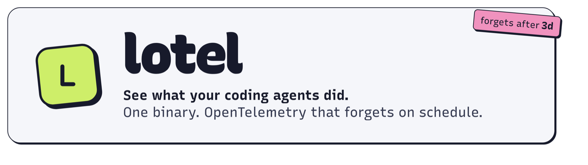
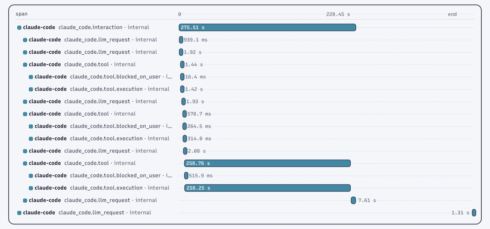
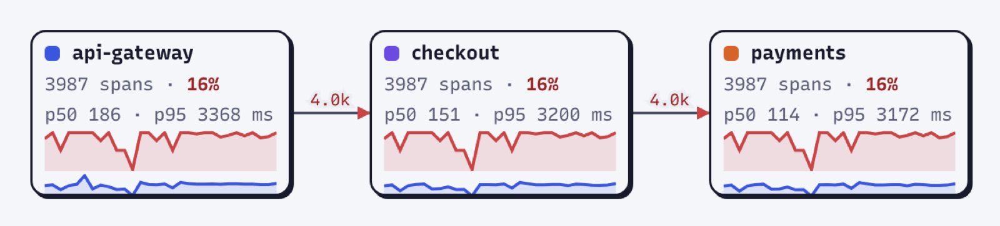
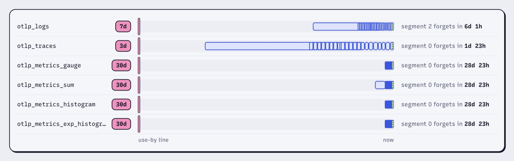

<p align="center">
  <a href="https://lotel.io">
    <picture>
      <source media="(prefers-color-scheme: dark)" srcset="docs/img/banner-night.png">
      
    </picture>
  </a>
</p>

<p align="center">
  <a href="https://lotel.io"><b>Website</b></a> &nbsp;·&nbsp;
  <a href="https://lotel.io/docs/"><b>Docs</b></a> &nbsp;·&nbsp;
  <a href="https://lotel.io/docs/quickstart/"><b>Quickstart</b></a> &nbsp;·&nbsp;
  <a href="https://github.com/hamin/lotel/releases"><b>Releases</b></a>
</p>

<p align="center">
  <a href="https://github.com/hamin/lotel/actions/workflows/ci.yml"></a>
  <a href="https://github.com/hamin/lotel/releases"></a>
  <a href="https://crates.io/crates/lotel"></a>
  <a href="LICENSE"></a>
</p>

lotel is one small binary that takes your coding agents' OpenTelemetry, shows
every session, and forgets it on schedule. Point Claude Code or Codex at it and
see each model call, tool run and permission wait on a timeline, with what it
cost.

<picture>
  <source media="(prefers-color-scheme: dark)" srcset="docs/img/session-night.jpg">
  
</picture>

- **One binary, nothing else to run.** OTLP/HTTP in, a web UI out, DuckDB
  inside. No collector, no JVM, no cluster, no Docker Compose.
- **Built for coding agents.** Sessions, spend and tool health for Claude Code
  and Codex, with prompt and tool text hidden unless you opt in.
- **Data with a use-by date.** Retention lives in the storage: whole Parquet
  files are deleted when they expire, so the disk never fills.
- **A whole OpenTelemetry backend.** Logs, traces, metrics, a service map and
  Explore, for your own apps too.

## Install

lotel runs on macOS and Linux, on arm64 and x86_64. Pick one:

**Install script**

```sh
curl -fsSL https://lotel.io/install.sh | sh
```

**Homebrew**

```sh
brew install hamin/tap/lotel
```

**Cargo**

```sh
cargo binstall lotel
```

Docker and building from source are in the [install docs](https://lotel.io/docs/install/).

## Quickstart

Start lotel:

```sh
lotel
```

Its startup banner shows the three things you need:

- **UI:** http://127.0.0.1:8080
- **OTLP endpoint:** `http://127.0.0.1:4318`
- **Bearer token:** a random token, or the one you set in `LOTEL_INGEST_TOKEN`

Then open http://127.0.0.1:8080/setup and paste its block into the shell you
run Claude Code or Codex from. Every model call, tool run and permission
decision shows up under Sessions, Spend and Tools. Your own apps can send to
the same endpoint with any OpenTelemetry SDK; see
[Sending telemetry](https://lotel.io/docs/sending-telemetry/).

## Features

### Every agent session, step by step

Claude Code and Codex already export OpenTelemetry. Point them at lotel and each
session becomes a timeline of model calls, tool runs and permission waits, with
what it cost under **Spend** and which tools failed under **Tools**. Prompt and
tool text stays hidden unless you opt in ([Privacy](https://lotel.io/docs/privacy/)).

### Explore any attribute

Group, filter and chart spans, logs and metrics by any attribute, with facet
counts beside the results.

<picture>
  <source media="(prefers-color-scheme: dark)" srcset="docs/img/explore-night.jpg">
  
</picture>

### A service map from your traces

Your own apps can send to the same endpoint. Services, the calls between them,
error rates and latency come straight from the spans.

<picture>
  <source media="(prefers-color-scheme: dark)" srcset="docs/img/services-night.jpg">
  
</picture>

### Data with a use-by date

Logs keep 7 days, traces 3 and metrics 30, or 2 GB per table, whichever comes
first. The Storage page shows every Parquet segment on its retention window and
when the next one goes ([Retention](https://lotel.io/docs/retention/)).

<picture>
  <source media="(prefers-color-scheme: dark)" srcset="docs/img/storage-night.jpg">
  
</picture>

## Documentation

Everything is at **[lotel.io/docs](https://lotel.io/docs/)**:

- [**Quickstart**](https://lotel.io/docs/quickstart/): run lotel and point your agents at it
- [**Install**](https://lotel.io/docs/install/): install script, Homebrew, cargo, Docker, source
- [**Sending telemetry**](https://lotel.io/docs/sending-telemetry/): OTLP endpoints, auth, SDK examples
- [**Retention**](https://lotel.io/docs/retention/): how and when data is forgotten
- [**Configuration**](https://lotel.io/docs/configuration/): every environment variable
- [**Privacy**](https://lotel.io/docs/privacy/): what is stored and what the UI shows
- [**The UI**](https://lotel.io/docs/ui/): each page, and the filter syntax

The same pages live in [`docs/`](docs/) in this repo.

## How it works

```
OTLP/HTTP :4318 ──▶ otlp extension ──▶ capped DuckDB tables ──▶ Parquet segments
                                                 │
                                       UI :8080 (sessions, spend, tools, logs, traces, metrics, storage)
```

Two DuckDB extensions are built into the binary and do the heavy lifting:

- **[capped](https://github.com/hamin/duckdb-capped)** is the storage layer.
  Each table is a set of sealed Parquet segments plus one open segment, and
  `WITH (ttl, max_bytes)` policies drop whole segments as they expire.
- **[otlp](https://github.com/smithclay/duckdb-otlp)** is the OTLP/HTTP
  receiver. It appends straight into the capped tables, which lotel creates
  with their limits before the receiver starts.

The UI is server-rendered with [Topcoat](https://github.com/tokio-rs/topcoat);
the live tail and charts poll small fragment and JSON endpoints.

## Development

You need Rust and [just](https://github.com/casey/just).

| Command | What it does |
| --- | --- |
| `just fetch-extensions` | Downloads the pinned `capped`, `otlp` and `fts` extensions |
| `cargo build --release` | Builds `target/release/lotel` |
| `cargo test` | Unit and database tests |
| `just smoke` | Boots the binary, ingests `testdata/`, checks every page |
| `just stress` | 30-second storm of concurrent ingest and page loads, with p95 gates |
| `just soak` | 10 minutes of sustained load, checking for leaks and growth |

`just fetch-extensions` downloads the pinned `capped`, `otlp` and `fts`
builds listed in `crates/lotel/extensions.lock` and checks each one's sha256. `capped`
comes from its [GitHub release](https://github.com/hamin/duckdb-capped/releases);
set `CAPPED_EXT=/path/to/capped.duckdb_extension` to use a local build. All three are then
`include_bytes!`-embedded, so the shipped binary needs nothing at runtime.
`just dist` refuses to run against stubbed (zero-byte) blobs and boots the
tarball's own binary as an ingest gate, so a release can't silently ship dead.

Releases are cut by pushing a `v<version>` tag: `.github/workflows/release.yml`
builds the four tarballs, publishes them with `SHA256SUMS.txt`, and updates
the Homebrew formula.

### Changing the look

The UI's look is owned by `design/useby`: its `build.py` generates the token
blocks and `useby.css` is the component sheet. `src/skin.rs` is generated from
them, never edited by hand. After editing either file:

1. Check contrast. This must report 0 failing pairs:
   ```sh
   python3 design/useby/build.py --check
   ```
2. Regenerate the skin, then rebuild:
   ```sh
   python3 scripts/gen-skin.py
   cargo build
   ```

### The test ladder

| gate | command | what it proves |
| --- | --- | --- |
| units | `cargo test` | query builders, facet/latency logic, pool concurrency |
| smoke | `just smoke` | every page renders, ingest + caps + search work end to end |
| stress | `just stress` | 12 threads x 30s storm: zero failures, p95 under budget, no panics |
| soak | `just soak` | 10 min sustained ingest: live heap bounded, no fd/thread growth, caps held |
| agent stress | `N=500 just agent-stress` | agent pages over 500 replayed fixture copies: p95 under 500 ms, no query errors, live heap and caps held |

Soak and stress are deliberately **local**, not CI: they run on their own
ports beside a dev server, and a 10-minute soak on a shared runner buys
nothing a nightly laptop run doesn't. The DuckDB/extension side has its own
memory gate: `GEN=ninja make asan` in [duckdb-capped](https://github.com/hamin/duckdb-capped) builds Release with
AddressSanitizer and runs the whole sqllogictest suite inside it. The full
reference (gates, tunables, results, and the macOS allocator investigation)
is in [`docs/load-testing.md`](docs/load-testing.md).

One honest caveat, measured rather than guessed: on macOS, RSS after a
traffic flood reads high (gigabytes) while the *live heap* is ~40 MB:
libmalloc retains freed pages and `malloc_zone_pressure_relief` cannot force
them back (verified with a C probe). That is allocator policy, not lotel
holding data, so the soak gates the live heap (vmmap bytes-allocated) plus
RSS drift, instead of pretending an RSS ceiling is meaningful there.

## License

Apache-2.0. See [LICENSE](LICENSE) and [NOTICE](NOTICE). NOTICE names the
bundled third-party components: DuckDB, the embedded `otlp` and `fts`
extensions (MIT), uPlot (MIT), the five UI fonts (SIL OFL 1.1, full texts
under
[`crates/lotel/assets/fonts/LICENSES/`](crates/lotel/assets/fonts/LICENSES/)),
and [`capped`](https://github.com/hamin/duckdb-capped) (Apache-2.0). The Rust crates compiled into the binary ship
their own licenses as `THIRD-PARTY-LICENSES` next to `LICENSE` in the tarball
and image.
