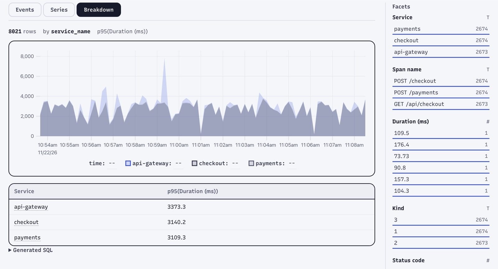

# lotel

**See what your coding agents did.** One small binary takes their OpenTelemetry,
shows every session, and forgets it on schedule.

<picture>
  <source media="(prefers-color-scheme: dark)" srcset="docs/img/session-night.jpg">
  
</picture>

lotel accepts OTLP/HTTP, stores logs, traces and metrics in DuckDB, and serves
its UI on localhost. Retention is enforced by the storage itself: whole Parquet
files are deleted when they pass their use-by date, so the disk never fills.
No collector, no JVM, no cluster, no Docker Compose.

## Install

```sh
curl -fsSL https://lotel.io/install.sh | sh     # or: brew install hamin/tap/lotel
                                                #     cargo binstall lotel
```

macOS and Linux, arm64 and x86_64. More ways (Docker, from source) in
[Install](docs/install.md).

## Quickstart

```sh
lotel    # UI on http://127.0.0.1:8080, OTLP on 127.0.0.1:4318, token in the banner
```

Open http://127.0.0.1:8080/setup and paste its block into the shell you run
Claude Code or Codex from. Every model call, tool run and permission decision
then shows up under Sessions, Spend and Tools. Your own apps can send to the
same endpoint with any OpenTelemetry SDK.

## What you get

### Every agent session, step by step

Claude Code and Codex already export OpenTelemetry. Point them at lotel and each
session becomes a timeline of model calls, tool runs and permission waits, with
what it cost under **Spend** and which tools failed under **Tools**. Prompt and
tool text stays hidden unless you opt in ([Privacy](docs/privacy.md)).

### Explore any attribute

Group, filter and chart spans, logs and metrics by any attribute, with facet
counts beside the results.

<picture>
  <source media="(prefers-color-scheme: dark)" srcset="docs/img/explore-night.jpg">
  
</picture>

### A service map from your traces

Your own apps can send to the same endpoint. Services, the calls between them,
error rates and latency come straight from the spans.

<picture>
  <source media="(prefers-color-scheme: dark)" srcset="docs/img/services-night.jpg">
  
</picture>

### Data with a use-by date

Logs keep 7 days, traces 3 and metrics 30, or 2 GB per table, whichever comes
first. The Storage page shows every Parquet segment on its retention window and
when the next one goes ([Retention](docs/retention.md)).

<picture>
  <source media="(prefers-color-scheme: dark)" srcset="docs/img/storage-night.jpg">
  
</picture>

## Docs

The docs live in [`docs/`](docs/) and on [lotel.io/docs](https://lotel.io/docs/):

- [Quickstart](docs/quickstart.md): run it and point your agents at it
- [Install](docs/install.md): install script, Homebrew, cargo, Docker, source
- [Sending telemetry](docs/sending-telemetry.md): OTLP endpoints, auth, SDK examples
- [Retention](docs/retention.md): how and when data is forgotten
- [Configuration](docs/configuration.md): every environment variable
- [Privacy](docs/privacy.md): what is stored and what the UI shows
- [The UI](docs/ui.md): each page, and the filter syntax

## How it works

```
OTLP/HTTP :4318 ──▶ otlp extension ──▶ capped DuckDB tables ──▶ Parquet segments
                                                 │
                                       UI :8080 (sessions, spend, tools, logs, traces, metrics, storage)
```

Two DuckDB extensions, embedded into the binary at compile time and
materialized to `<data>/extensions/` at boot:

- [`capped`](https://github.com/hamin/duckdb-capped) provides
  the storage layer: tables
  are sealed parquet segments plus one open segment, `WITH (time_col, ttl,
  max_bytes)` policies enforce retention at the segment level, and
  `capped_tables()` / `capped_status()` expose the truth.
- the community [`otlp`](https://github.com/smithclay/duckdb-otlp) extension
  provides `otlp_serve()`: an OTLP/HTTP receiver that appends directly into
  the capped tables (lotel pre-creates the six canonical `otlp_*` tables with
  cap policies so the receiver never creates an uncapped one).

The UI is [Topcoat](https://github.com/tokio-rs/topcoat) server-rendered
views; the live tail and charts poll small bare fragment/JSON endpoints.

## Building

```sh
just fetch-extensions   # downloads the pinned capped, otlp and fts extensions
cargo build --release   # target/release/lotel
cargo test              # unit tests (the database tests need the extensions)
just smoke              # boots the binary, ingests testdata/, checks every page
just stress             # 30s storm: concurrent ingest + every endpoint, p95 gates
just soak               # 10 min sustained: watchdog over all pages, leak/fd/heap gates
```

`just fetch-extensions` downloads the pinned `capped`, `otlp` and `fts`
builds listed in `crates/lotel/extensions.lock` and checks each one's sha256. `capped`
comes from its [GitHub release](https://github.com/hamin/duckdb-capped/releases);
set `CAPPED_EXT=/path/to/capped.duckdb_extension` to use a local build. All three are then
`include_bytes!`-embedded, so the shipped binary needs nothing at runtime.
`just dist` refuses to run against stubbed (zero-byte) blobs and boots the
tarball's own binary as an ingest gate, so a release can't silently ship dead.

Releases are cut by pushing a `v<version>` tag: `.github/workflows/release.yml`
builds the four tarballs, publishes them with `SHA256SUMS.txt`, and updates
the Homebrew formula.

### Changing the look

The UI's look is owned by `design/useby` (its `build.py` generates the token
blocks; `useby.css` is the component sheet), and `src/skin.rs` is generated
from it, never hand-edited:

```sh
# edit design/useby/build.py or useby.css
python3 design/useby/build.py --check   # WCAG contrast gate; must be 0 failing pairs
python3 scripts/gen-skin.py             # regenerates src/skin.rs from design/useby
cargo build
```

## The test ladder

| gate | command | what it proves |
| --- | --- | --- |
| units | `cargo test` | query builders, facet/latency logic, pool concurrency |
| smoke | `just smoke` | every page renders, ingest + caps + search work end to end |
| stress | `just stress` | 12 threads x 30s storm: zero failures, p95 under budget, no panics |
| soak | `just soak` | 10 min sustained ingest: live heap bounded, no fd/thread growth, caps held |
| agent stress | `N=500 just agent-stress` | agent pages over 500 replayed fixture copies: p95 under 500 ms, no query errors, live heap and caps held |

Soak and stress are deliberately **local**, not CI: they run on their own
ports beside a dev server, and a 10-minute soak on a shared runner buys
nothing a nightly laptop run doesn't. The DuckDB/extension side has its own
memory gate: `GEN=ninja make asan` in [duckdb-capped](https://github.com/hamin/duckdb-capped) builds Release with
AddressSanitizer and runs the whole sqllogictest suite inside it. The full
reference (gates, tunables, results, and the macOS allocator investigation)
is in [`docs/load-testing.md`](docs/load-testing.md).

One honest caveat, measured rather than guessed: on macOS, RSS after a
traffic flood reads high (gigabytes) while the *live heap* is ~40 MB:
libmalloc retains freed pages and `malloc_zone_pressure_relief` cannot force
them back (verified with a C probe). That is allocator policy, not lotel
holding data, so the soak gates the live heap (vmmap bytes-allocated) plus
RSS drift, instead of pretending an RSS ceiling is meaningful there.

## License

Apache-2.0. See [LICENSE](LICENSE) and [NOTICE](NOTICE). NOTICE names the
bundled third-party components: DuckDB, the embedded `otlp` and `fts`
extensions (MIT), uPlot (MIT), the five UI fonts (SIL OFL 1.1, full texts
under
[`crates/lotel/assets/fonts/LICENSES/`](crates/lotel/assets/fonts/LICENSES/)),
and [`capped`](https://github.com/hamin/duckdb-capped) (Apache-2.0). The Rust crates compiled into the binary ship
their own licenses as `THIRD-PARTY-LICENSES` next to `LICENSE` in the tarball
and image.
