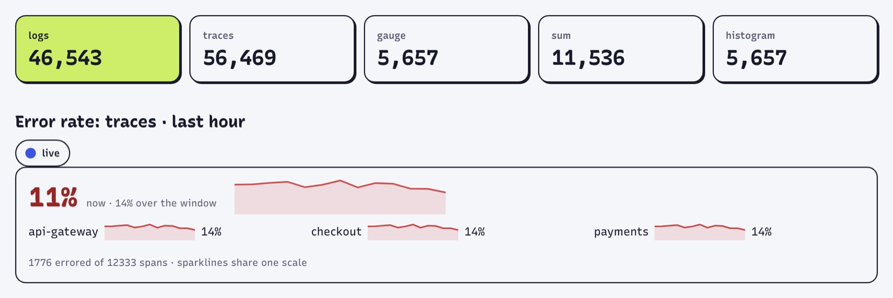
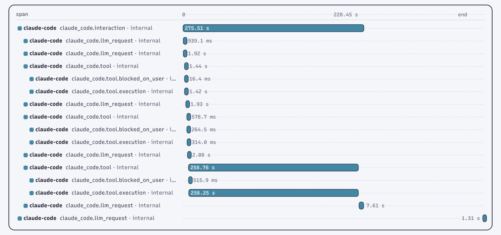
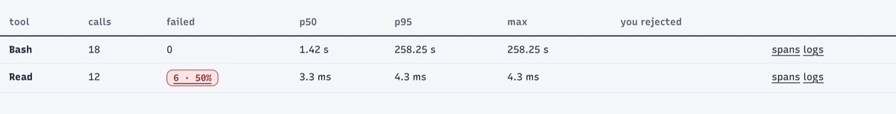
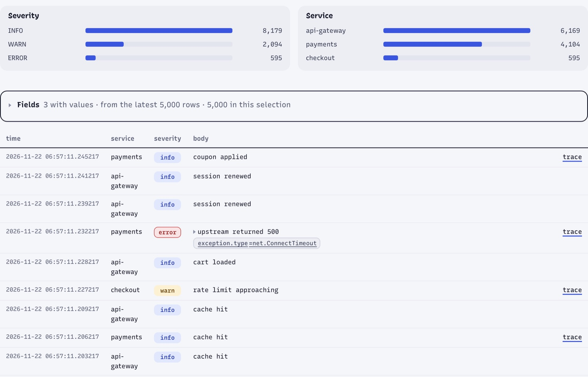
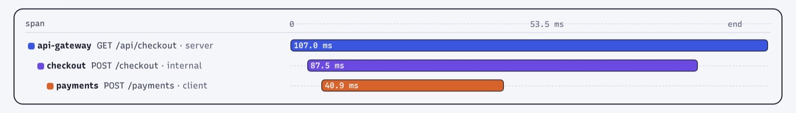
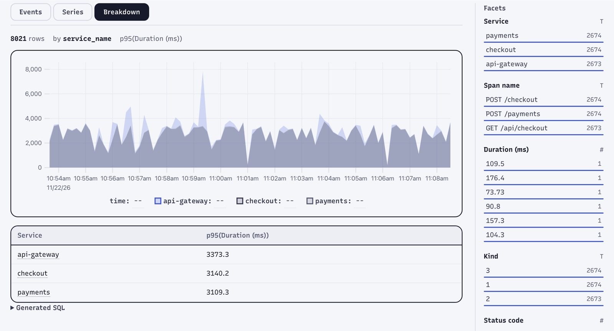
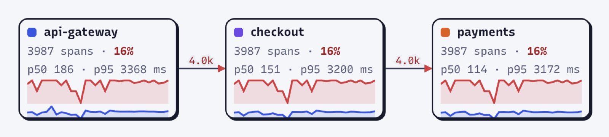
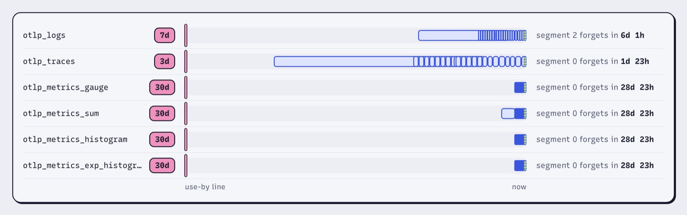

# The UI

lotel serves its UI at http://127.0.0.1:8080. Pages are rendered on the server. A small script adds live updates, charts and faster navigation. The sidebar groups them: the Dashboard, then **Agents**, then **Telemetry**.

Most pages share one filter bar. See [Filters](#filters) at the end of this page.

## Dashboard

`/` gives an overview of the instance:

- Row counts for logs, traces, and gauge, sum and histogram metrics.
- The trace error rate over the last hour. It refreshes every 10 seconds while "live" is checked.
- The OTLP receiver's stats: requests, rows, buffered rows, seals and the last error.
- The store's tables with their segment, row and byte counts.
- Runtime details: DuckDB and capped versions, the data directory and the OTLP endpoint.
- A copy-paste block of exporter settings with this instance's endpoint and token.

## Agents

### Sessions

`/sessions` lists one row per coding agent session, across Claude Code, Codex and opencode: the agent, event and span counts, cost, tokens in and out, and when it was last seen. Each row links to its logs, and to its traces when it has spans.

Click a session to open its timeline at `/sessions?session=<id>`. It shows the session's spans as a waterfall and every event in order, with runs of the same event folded into one row. Click a span to see its details.

### Spend

`/spend` shows what your agents cost, by day, model and developer: cost in USD, tokens in, out and from cache, and active time when the agent reports it. Totals for the view sit above the table.

The numbers come from the agents' cost and token metrics. Points that are running totals (cumulative temporality) are not added up, so nothing is counted twice. On days without those metrics, lotel fills in from the agents' `api_request` events, and the page notes it.

### Tools

`/tools` shows one row per tool your agents called: calls, failures, p50, p95 and max duration, and how many calls you rejected. Each count links to the spans and logs behind it.

Durations come from tool spans and measure the execution, not the time spent waiting for your approval. If the view has no tool spans, the page falls back to the tool-call counters and shows no durations.

### Setup

`/setup` has copy-paste blocks that point an agent at this instance, with the endpoint and token filled in. It has three tabs: Claude Code, Codex as a config file, and Codex for one run. The endpoint uses the host name your browser used to reach the UI. See [Quickstart](quickstart.md).

## Telemetry

### Logs

`/logs` lists recent log records, newest first. Filter by service, severity, time range and attributes. The severity and service facets show counts and narrow the list when you click them. The Fields panel lists the attributes in the current view.

- **Live tail**: while it is on, new rows appear every 3 seconds.
- **Search**: text in the search box runs a ranked full-text search over sealed segments. Rows in the open segment are not indexed yet, so the plain list below still matches raw text.
- **JSON bodies**: a JSON body, such as an agent event, renders as a message plus `key=value` chips. Click a chip to filter on it.
- **Trace links**: a row links to its trace when that trace is still stored.

### Traces

`/traces` shows spans. Filter by service, span name, status, minimum duration in milliseconds, time range and attributes. The page shows the overall p95 over time, a span duration distribution, a per-service summary and the recent spans.

Open a trace at `/traces?trace=<id>` for its waterfall: spans in tree order, placed by start time and duration, colored by service, with errors outlined. Click a span for its attributes. When logs carry the trace or span id, a link shows how many and opens them on `/logs`.

### Metrics

`/metrics` lists every metric by shape, name, unit and service, with its point count, latest time and an example value. Click one to chart it: gauges and sums as time series, histograms as a distribution.

### Explore

`/query` queries the store in two modes:

- **Query builder**: pick a dataset (logs, traces or one of the metric shapes), add filters, measures (count, count distinct, average, sum, min, max, p50, p90, p95, p99) and a breakdown by any column, attributes included.
- **SQL console**: run one read-only SQL statement against the tables, for example `SELECT * FROM otel.main.otlp_logs LIMIT 100`. Statements that write, attach, load or copy are rejected.

Results go through the same content masking as the other pages. See [Privacy](privacy.md).

### Services

`/services` is a service map built from parent and child spans. Each node is a service, and each edge is labeled with its call count. An edge is red when at least 2% of its calls are errors. Click a service to open its spans. The page also shows error-rate and p95 trends.

### Storage

`/storage` shows what is on disk and what forgets next: every table and segment with its rows, bytes, time range and caps. See [Retention](retention.md).

## Filters

Logs, Traces, Sessions, Spend and Tools share a filter box. Write one filter per line. Filters combine with AND.

| Write | Matches |
| --- | --- |
| `key=value` | Rows whose attribute `key` is exactly `value` |
| `key!=value` | Rows that have `key` with a different value |
| `key~text` | Rows whose `key` contains `text`, ignoring case. `%` and `_` act as wildcards. |
| `resource.key=value` | The same, against the resource attributes |
| `body.key=value` | The same, against the parsed JSON body (logs only) |

`!=` and `~` skip rows that don't have the key, so a filter only narrows. A line that doesn't parse is flagged next to the box.

Filters also work in the URL as repeated `f` parameters, for example `/logs?f=tool_name%3DBash&f=success%3Dfalse`. Time ranges are `15m`, `1h`, `6h`, `24h`, `7d`, `30d` or `all`, set with `range=`.

## Look and feel

The settings panel in the top bar switches the palette, scheme (day, night or auto), font and style. The choice is stored in a cookie. Each option is also a URL parameter, so any look is a link, for example `/?pal=riso&scheme=night&font=onest&style=crisp`. The fonts are embedded in the binary, so the UI makes no outside network requests.

Beside the settings panel, the "forgets after" stickers show the retention lotel was started with for logs, traces and metrics.
